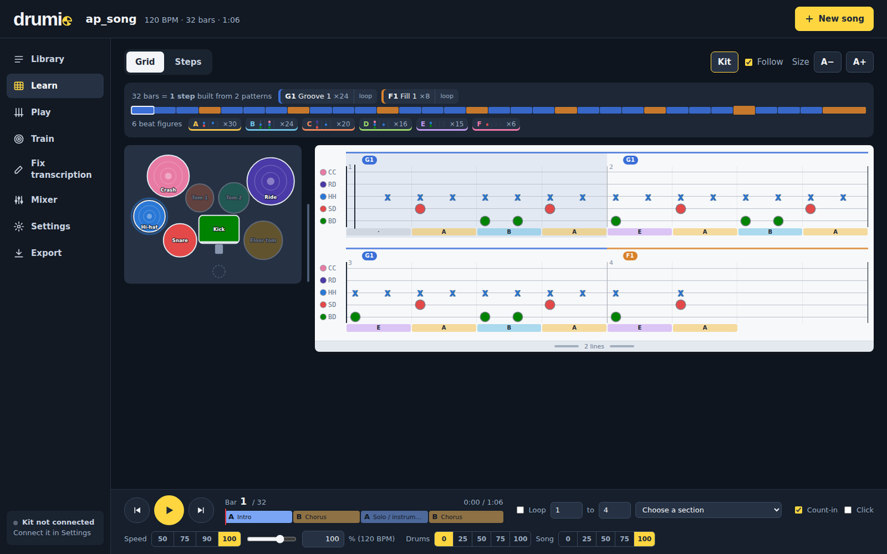
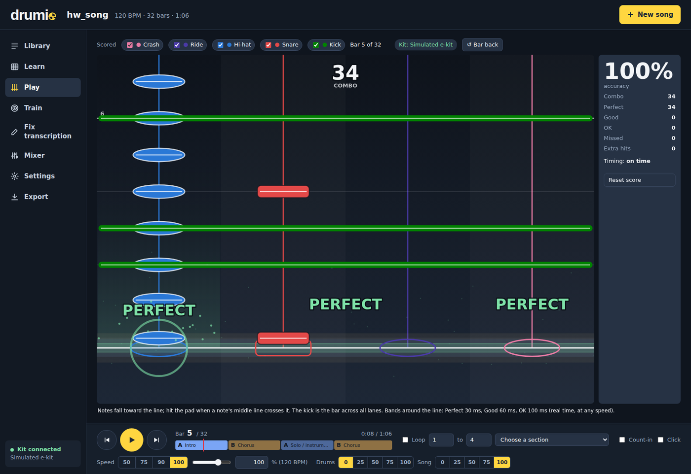
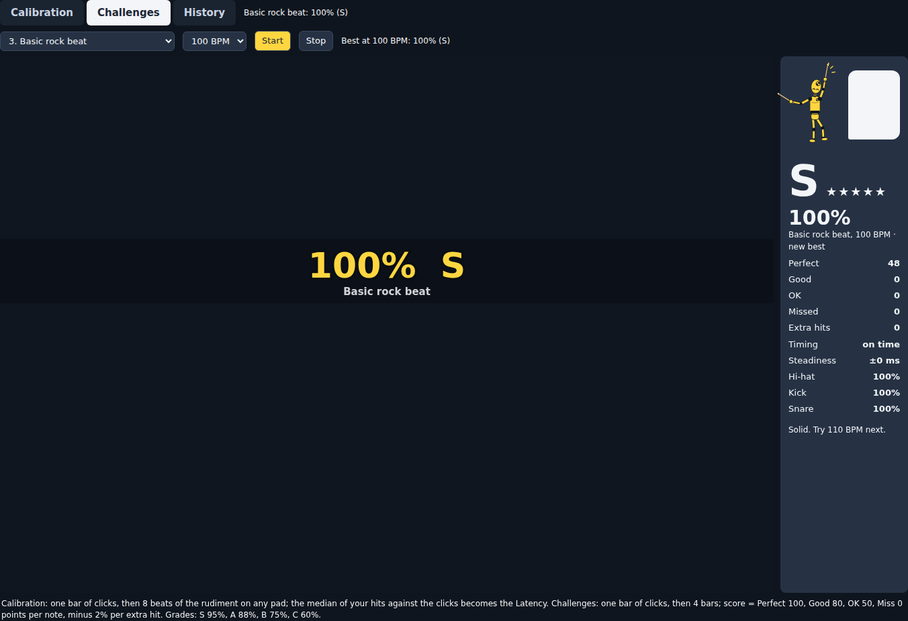
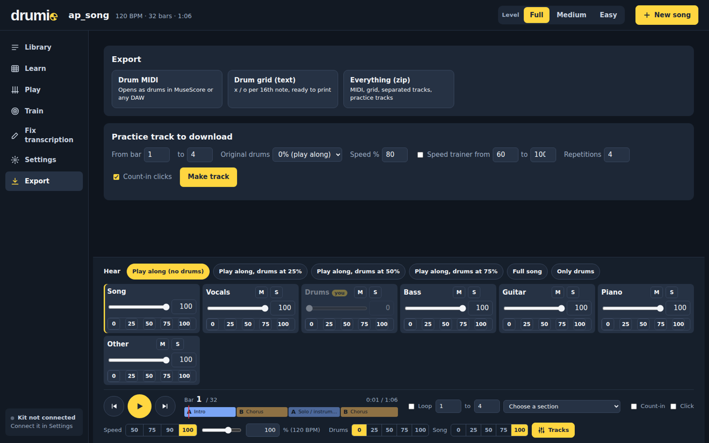
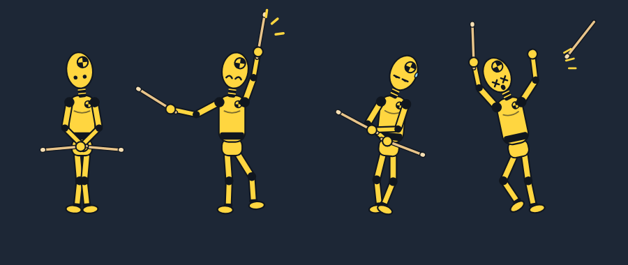

# Drumie

Turn any song into a drum lesson you can play on your electronic kit.

Paste a link (a studio track, a live video, a song nobody ever wrote a drum chart for), and Drumie
separates the drums, transcribes every hit, finds the grooves the song is built from, and gives you
a synced player with a kit diagram, a drum grid, practice steps and a Guitar Hero style highway you
play on your e-kit over MIDI. Everything runs on your own computer.

Drumie is also the mascot: a crash test dummy who learns drums the hard way, because learning an
instrument means taking a few hits.

> Resumo em português no fim da página.

**Status:** free, closed source, in private testing. A download for Windows is planned; until then
Drumie isn't available to install. Every version and what changed in it:
[CHANGELOG.md](CHANGELOG.md) (also on the [Releases](../../releases) page). Design notes and every
measurement behind the decisions (Portuguese): [docs/PROJETO.md](docs/PROJETO.md).

Questions, ideas or a song it gets wrong: open an [issue](../../issues).

| Play: the highway on your MIDI kit | Train: challenges with a grade |
|---|---|
|  |  |

## What you get

The app is organized like a practice room: a **Library** with your songs, and for the open song
one section per job, in a sidebar (a narrow rail on laptops, a row of tabs on a phone):
**Learn** (kit, grid, steps), **Play** (highway on your MIDI kit), **Train** (calibration,
challenges, history), **Fix transcription**, **Settings** (kit, pad map, timing, storage) and
**Export**. The play bar at the bottom (play, bar, loop, speed, drums/song volume) stays the same
in every section, so the music keeps going while you switch, and its **Tracks** button opens the
mixer (a volume, mute and solo per instrument, and presets) right there, in any section.

- **Library**: paste a link or upload a file, watch the analysis progress, open, analyze again
  or delete songs, search, and see the disk they use.
- **Kit seen from above**, each piece in its own color; it flashes when hit, and a ring grows
  during the beat before its next hit. **Drumie plays it with you**: his floating forearms, hands
  (marked R and L), sticks and feet move with the music, so you see which hand plays what, how it
  travels between drums and when the right foot presses the kick (a raised hand comes up toward
  you and its stick looks shorter from above).
- **Drum grid** (x = cymbal, o = drum, one column per 16th note) in the same colors, scrolling
  with the music. The playhead crosses each mark exactly when it sounds; the page glides to the
  next line during the last beat of a line. Drag the grip under the grid to see 1 to 8 lines ahead.
- **Patterns**: the grooves and fills the song is made of ("Groove 1 x18, Fill 1 x8"), a colored
  band with one square per bar, and a click to show only the bars of one pattern.
- **Beat figures**: one level down, every beat gets a letter: plain rock reads "A B C B"
  (A = kick + hi-hat, B = snare + hi-hat, C = kick on the beat and the "&"). A chip per figure
  shows a tiny drawing of its four 16ths and how often it's played; click it to light up every
  beat that plays it. Most songs come down to a handful of figures.
- **Steps**: the song as a handful of steps instead of 120 bars. A step is a groove played a
  few times plus the fill that closes the phrase; the view shows that groove once, and every
  time it comes round again the playhead sweeps back and a counter goes up ("2 of 3", "pass 1 of 6").
- **Highway** for an electronic kit over MIDI (Chrome/Edge, Web MIDI): notes fall to a hit
  line, each hit judged in real time (Perfect 30 ms, Good 60 ms, OK 100 ms), accuracy, combo,
  rushing/dragging, a score per loop pass, latency calibration, "learn" to map any pad, and a
  MIDI monitor that shows what each pad of your kit sends. Notes follow the music you hear (the
  audio output latency is compensated; "Note delay" for the rest), and hits burst on their pad
  with big PERFECT / GOOD / OK texts, a combo counter and streak banners. Latency is calibrated
  by playing a rudiment (quarter notes, singles, doubles, paradiddle) with a click; a pad can
  be learned as play/pause. Timing bands drawn to scale around the hit line show the Perfect /
  Good / OK windows.
- **Training**: latency calibration with a rudiment, and nine rhythm challenges (quarter notes to
  paradiddles and fills, 60 to 140 BPM) with a metronome and a final score, grade and timing report.
  A **History** tab lists every challenge you played (date, rhythm, tempo, score, timing).
- **Practice controls**: speed 40% to 125% without changing pitch, loop any bars or a section,
  count-in, click track, a mixer with a volume/mute/solo per instrument and one-tap 0 / 25 / 50 /
  75 / 100% buttons (play along with the drums muted or low), a master volume, every slider also
  typeable, layout remembered.
- **Difficulty, 1 to 10** for every song and every level (Beginner, Intermediate, Advanced,
  Expert), from how fast the hands and the kick play, off-beat kicks and snares, fills and how many
  different grooves the song has; the Library sorts by it (easiest or hardest first), and the
  header says why a song rates what it does.
- **Levels: Full, Medium, Easy** (top of the page, remembered per song): Medium drops ghost
  notes and plays everything on 8th notes; Easy keeps a quarter-note beat with the snare on the
  beat and turns fills into the groove, so you can play the whole song early on. The grid, the
  steps, the kit and the highway all follow the level. The easier levels also hide most of the
  AI's mistakes, which are mostly ghost notes and soft hits.
- **Practice one piece**: split the drums into kick, snare, toms, hi-hat, ride and crash (optional
  model), then mute just the piece you want to play while the rest of the kit keeps going; the grid
  dims the other rows. Each piece also gets its own volume in Tracks.
- **Fix transcription**: sensitivity per piece (kick, snare, hi-hat, toms, cymbals) and
  add/remove hits by clicking the grid. **Copy this bar to every repeat**: fix one bar and every
  other bar of the same groove gets the same hits. Your edits survive re-analysis.
- **Export**: drum MIDI (General MIDI, channel 10), a text drum grid, the separated audio, and a
  practice track to download (bars, speed or a speed ladder, drums volume, repetitions, count-in).

Keys: Space play/pause, arrows jump a bar, L toggles the loop.

## How accurate is it

Measured on [MDB Drums](https://github.com/CarlSouthall/MDBDrums) (23 real recordings,
~8,000 hits annotated by hand), F1 (1.0 = every hit found and nothing invented):

| Path | Kick | Snare | Hi-hat | Cymbals | Toms |
|---|---|---|---|---|---|
| Clean drum recording (best possible case) | 0.96 | 0.80 | 0.86 | 0.87 | 0.53 |
| **Full song, drums separated by the app (what you get)** | **0.93** | **0.77** | **0.86** | **0.86** | **0.46** |
| Full song, no separation | 0.85 | 0.70 | 0.85 | 0.83 | 0.47 |

- Kick, hi-hat and cymbals are reliable; snare is good; **ghost notes and the hi-hat pedal are
  the main misses** (about half of each), and toms are the weak spot.
- Crash vs ride is decided by how long the cymbal rings (94% right).
- Open vs closed hi-hat is not distinguished.
- The bar grid follows the drummer: on 14 rock/pop/funk recordings, bar lines land on the right
  beat 88% of the time (65% with the beat tracker alone).

What was tried and left out because it didn't help on this data (noise gate, averaging two
separations, mixing stem and full-mix predictions, timbre relabeling) is documented, with
numbers, in [docs/PROJETO.md](docs/PROJETO.md).

## Where things run

Everything runs locally; no audio leaves your computer.

| Step | Model / library | Runs on |
|---|---|---|
| Download | yt-dlp | your PC (internet: the song) |
| Separation | Demucs htdemucs_6s, plus the drum model of htdemucs_ft | your PC, GPU if available |
| Drum hits | ADTOF (PyTorch) | your PC, CPU |
| Tempo, bar grid, patterns, steps | librosa, numpy, scipy (no AI) | your PC |
| Interface | a small FastAPI server + your browser | your PC (localhost) |

The "agents" in the code are plain Python, not calls to a language model. The server only
listens on 127.0.0.1 and only serves files from the songs folder.

## Roadmap

1. Read each pad's MIDI note on a real kit (the monitor is in place), then add lanes and rows for
   open/pedal hi-hat, ride bell and rim, and export with the kit's own note map.
2. A x2 / /2 tempo button for songs detected at half or double speed.
3. A downbeat model (`beat_this`) for songs with tempo changes.
4. Import an existing drum MIDI, to compare with the transcription or to use it instead.

## Licenses

Drumie is free to use and closed source: see [LICENSE](LICENSE) (personal, non-commercial use; no
redistribution or modification). Versions 0.24.0 to 0.33.0 were published under the MIT License,
and copies of those versions keep it.

It is built on other people's software and models, each under its own license:
[THIRD_PARTY_NOTICES.md](THIRD_PARTY_NOTICES.md). Notably:

- **ADTOF** model weights: CC BY-NC-SA 4.0 (non-commercial). Installed separately.
- **DrumSep** model weights (Practice one piece, optional): no published license; treated as
  non-commercial. Downloaded on first use.
- Demucs: MIT. Basic Pitch: Apache 2.0. Gradio: Apache 2.0. librosa: ISC.
- MDB Drums (used only by the benchmark, not included): CC BY-NC-SA 4.0.

---

## Resumo em português

**Drumie** transforma qualquer música (inclusive ao vivo, sem partitura oficial) numa aula de
bateria para tocar na bateria eletrônica. Cole o link: o app separa a bateria, transcreve cada
batida, acha os grooves e viradas, e abre um player com o kit visto de cima, a grade de bateria, o
modo Steps e o Highway (estilo Guitar Hero) tocado no seu kit via MIDI. Tudo roda no seu computador.
O mascote é o Drumie, um boneco de testes desengonçado que aprende bateria levando pancada.

**Situação:** grátis e de código fechado, em teste fechado. Um instalador para Windows está nos
planos; até lá o app não está disponível para instalar. O histórico de versões está no
[CHANGELOG](CHANGELOG.md) e nas [Releases](../../releases).
